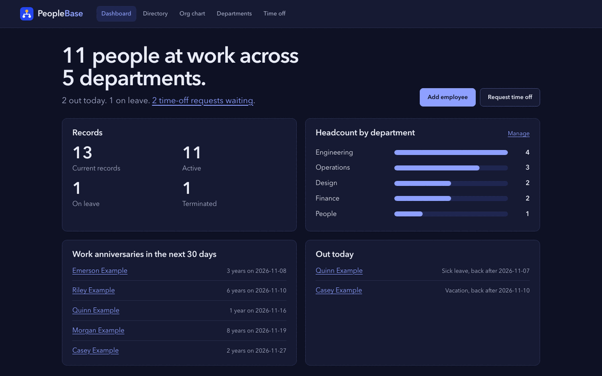

<div align="center">


**A small HR system you can read in one sitting.**

[](https://github.com/patrickking67/peoplebase/actions/workflows/ci.yml)
[](LICENSE)

**[patrickking67.github.io/peoplebase](https://patrickking67.github.io/peoplebase/)**

</div>

---

PeopleBase is a Flask and SQLAlchemy HR system for a small team: employee
records, departments, reporting lines, compensation history, time off with
manager approval and a people dashboard. It is deliberately compact, one
application module and a handful of templates, so the whole thing can be read
in a sitting. The point is the details a people-data tool has to get right:
CSRF protection, a strict Content-Security-Policy, spreadsheet-safe export,
strict validation and a test suite that covers each rule.



## Features

- **Employee records.** Name, job title, salary, department, manager, start
  date and status (active, on leave, left). Each person has a profile page.
- **Departments and reporting lines.** Create and remove departments, pick a
  manager for anyone and see the result as an org chart. Self-management,
  reporting loops and managers who have left are refused.
- **Compensation history.** Every title or salary change is stored with its
  effective date and reason. Hiring records the starting salary.
- **Time off.** Requests carry a type, inclusive dates (up to 60 days) and a
  note. Overlaps with pending or approved time off are refused. See
  [approval rules](#time-off-approval-rules).
- **Dashboard.** Who is at work, headcount by department, work anniversaries
  in the next 30 days, who is out today and how many requests are waiting.
- **Directory, reporting and CSV export.** Case-insensitive search across name
  and title, filters for department, title and status, payroll totals over
  every match, and a CSV of exactly the filtered set. Cells that start with
  `=`, `+`, `-`, `@`, tab or carriage return are prefixed with `'` so
  spreadsheets show them as text.
- **Security basics.** CSRF tokens on every form, `HttpOnly` and
  `SameSite=Lax` session cookies, a required `SECRET_KEY`, a strict CSP with
  no inline script, `nosniff`, frame denial, a 64 KiB request limit and error
  pages that never show exception details.
- **Demo data.** `flask --app app seed-demo` fills an empty database with 13
  made-up people named "Example".

## Quickstart

Requires Python 3.11 or newer.

```bash
git clone https://github.com/patrickking67/peoplebase.git
cd peoplebase
python3 -m venv .venv
source .venv/bin/activate
pip install -r requirements-dev.txt
export SECRET_KEY="$(python -c 'import secrets; print(secrets.token_hex(32))')"
flask --app app seed-demo
flask --app app run --debug
```

With [uv](https://docs.astral.sh/uv/), replace the venv and install lines with
`uv venv` and `uv pip install -r requirements-dev.txt`.

Open [http://127.0.0.1:5000](http://127.0.0.1:5000). The SQLite database is
created at `instance/employees.db`, which Git ignores. `seed-demo` is optional
and only runs on an empty database. The `--debug` flag is for local
development only.

`./scripts/dev.sh` does the same on port 4104 with a fake, development-only
`SECRET_KEY`. It is what `.claude/launch.json` starts.

## Configuration

Settings come from environment variables. See [`.env.example`](.env.example).
PeopleBase does not load `.env` on its own, so export it with
`set -a; source .env; set +a`.

| Variable | Required | Purpose | Default |
| --- | --- | --- | --- |
| `SECRET_KEY` | Yes | Signs the session cookie, flash messages and CSRF tokens. The app refuses to start without it. | None |
| `DATABASE_URL` | No | SQLAlchemy database URL | SQLite at `instance/employees.db` |
| `FLASK_DEBUG` | No | `1` turns on the debugger when running `python app.py` | Off |

Any WSGI server can serve the app by calling the factory `app:create_app()`.

## Time-off approval rules

PeopleBase has no login, so the person deciding a request is named on the
form and checked against the reporting line:

- The requester's manager decides.
- If the requester has no manager, or their manager has left, any other
  current employee can decide.
- Nobody decides their own request, and a decided request cannot be changed.

This keeps the workflow honest inside a trusted network. It is not access
control; see [Limits](#limits).

## Architecture

One module, `app.py`, holds the application factory, the four models
(`Department`, `Employee`, `CompensationChange`, `TimeOffRequest`), the routes
and the validation helpers. Templates are server-rendered Jinja with
autoescaping; the only JavaScript is a small confirm-before-delete handler in
`static/app.js`. `db.create_all()` creates new tables and `upgrade_schema()`
adds the newer employee columns to databases from earlier versions. Details in
[docs/architecture.md](docs/architecture.md).

```text
app.py                  Factory, models, routes, validation, seed-demo command
templates/              Jinja templates
static/                 styles.css, app.js, logo and favicons
tests/                  pytest suite and fixtures
scripts/                check.sh, dev.sh and repository checks
site/                   Static GitHub Pages landing page
docs/architecture.md    Design notes and production gaps
.github/                CI, Pages deployment, templates, Dependabot
```

## Tests

```bash
./scripts/check.sh
```

That runs `ruff check .`, `pytest -q` (176 tests, each on a fresh SQLite
database), `scripts/check-ai-config.py` and `scripts/check-text.py`. The suite
covers:

- CRUD, validation, escaping, error pages and layout (`tests/test_app.py`)
- search, filters, pagination, totals and CSV export (`tests/test_directory.py`)
- departments, reporting lines, compensation history and schema upgrades
  (`tests/test_hris.py`)
- time-off requests and approval rules (`tests/test_time_off.py`)
- dashboard, anniversaries, org chart and demo data (`tests/test_dashboard.py`)
- CSRF, cookies, headers, request limits, `SECRET_KEY` and CSV formula
  neutralization (`tests/test_security.py`)

GitHub Actions runs the same script on Python 3.11, 3.12 and 3.13 for every
pull request and every push to `main`.

## Deploy

The landing page in `site/` deploys to GitHub Pages from `main` through
`.github/workflows/pages.yml`. The app itself is not deployed anywhere.

## Limits

PeopleBase has no login. Anyone who can reach it can read and change every
record, and the time-off approver is chosen on the form rather than proven by a
session. Do not deploy it publicly or load real employee data without adding
authentication and authorization first. See [architecture](docs/architecture.md)
and the [security policy](SECURITY.md).

## License

MIT, see [LICENSE](LICENSE).
