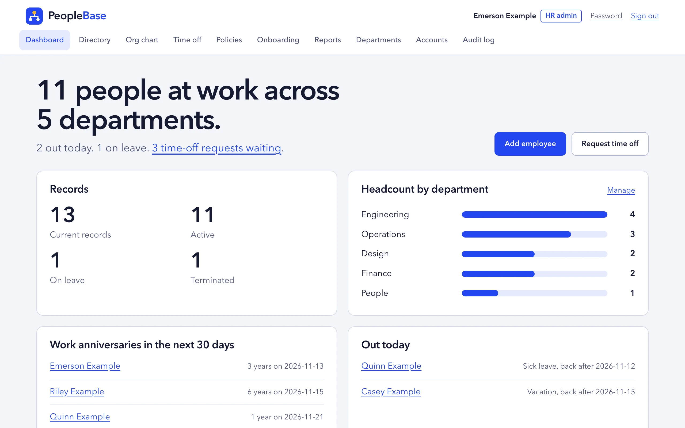
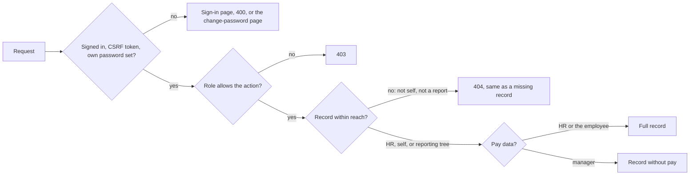
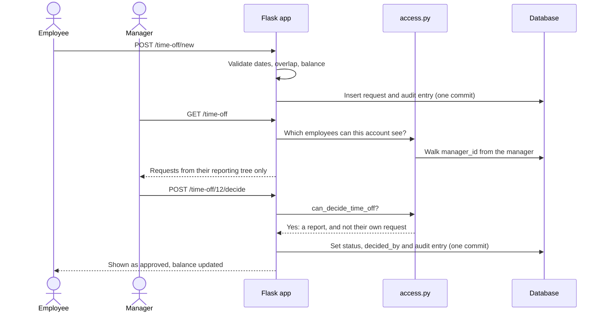
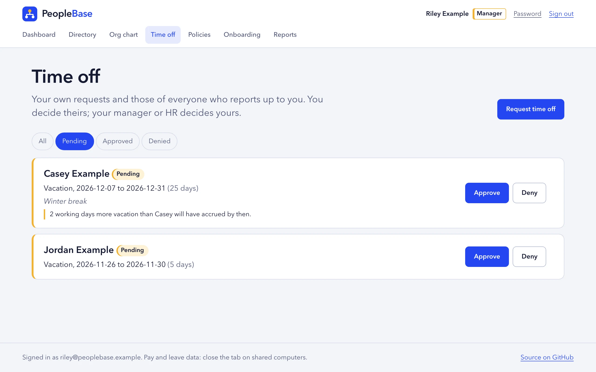

<div align="center">


**A small HR system where the access rules are the main feature: three roles, one policy module, and a test for every way around it.**

[](https://github.com/patrickking67/peoplebase/actions/workflows/ci.yml)
[](LICENSE)
[](#quality)
[](https://patrickking67.github.io/peoplebase/)

<picture>
  <source media="(prefers-color-scheme: dark)" srcset="site/assets/dashboard-dark.webp">
  
</picture>

</div>

PeopleBase is a Flask and SQLAlchemy HRIS (human resources information system)
for a small company: people records, pay history, time off with approval,
onboarding checklists, policy sign-off, a headcount report and an audit log.
HR, managers and employees each sign in and see only what their role and
reporting line allow.

## Try it

- **Project page:** [patrickking67.github.io/peoplebase](https://patrickking67.github.io/peoplebase/)
  (screenshots and the security model; the app itself is not hosted anywhere).
- **Run it locally** with Python 3.11 or newer:

```bash
git clone https://github.com/patrickking67/peoplebase.git && cd peoplebase
python3 -m venv .venv && .venv/bin/pip install -r requirements-dev.txt
./scripts/dev.sh --demo      # creates the tables, loads fake people, serves http://127.0.0.1:4104
```

`--demo` prints three sign-ins (HR admin, manager, employee) at
`@peoplebase.example` and one random password generated for that run. Without
it, create your first HR admin with `flask --app app create-admin`.

## What is technically interesting here

- **One policy module decides everything.** [`access.py`](access.py) is about
  100 lines: a role grants a capability and the reporting line sets its reach.
  [`test_route_access_by_role`](tests/test_access.py) holds a table of every
  route and the status each role must get, and fails when a route is added
  without an entry.
- **Out of reach looks exactly like missing.** Changing the id in
  `/employees/7` returns the same bytes as an id that does not exist, so ids
  cannot be probed
  ([`test_out_of_reach_profile_looks_exactly_like_a_missing_one`](tests/test_access.py)).
- **Signed-cookie sessions that can still be revoked.** Each account carries a
  nonce copied into the cookie; sign-out, a password change or a role change
  rotates it, so a cookie copied earlier stops working
  ([`tests/test_auth.py`](tests/test_auth.py)).
- **Lockout without account enumeration.** Failed sign-ins are counted against
  the email as typed, not the account, and an unknown email still costs one
  Argon2id verification, so real and made-up addresses behave the same.
- **An audit log the app cannot rewrite.** Entries are written in the same
  transaction as the change, and the model refuses updates and deletes, per
  row and in bulk ([`models.py`](models.py),
  [`tests/test_audit.py`](tests/test_audit.py)).
- **Migrations that meet old databases where they are.** The baseline revision
  upgrades three historical schema shapes to one, and a test compares the
  migrated schema to the models on SQLite and PostgreSQL
  ([`tests/test_migrations.py`](tests/test_migrations.py)).

## Architecture

Server-rendered Flask. Every request passes the same gates before a route runs,
and every route asks `access.py` before it reads or writes.



Time off shows the pieces working together: the decider is the signed-in
account, never a form field, and the decision and its audit entry commit
together.



The data model (an `erDiagram`), the component view and the audit mechanism
are in [docs/architecture.md](docs/architecture.md). The threat model, with
16 abuse cases and the test for each, is in [docs/security.md](docs/security.md).

| Role | Sees | Can change |
| --- | --- | --- |
| Employee | Own record, pay, leave balances, checklist; the directory and org chart | Own time-off requests, own policy acknowledgements, own password |
| Manager | The same, plus records, time off and checklists of direct and indirect reports. Not their pay. | Approve or deny reports' time off, tick their checklist tasks |
| HR admin | Everything, including pay, people who left, reports and the audit log | Records, departments, accounts and roles, policies |

<picture>
  <source media="(prefers-color-scheme: dark)" srcset="site/assets/approvals-dark.webp">
  
</picture>

More screens: [org chart](site/assets/org-chart-light.webp),
[employee profile](site/assets/profile-light.webp),
[audit log](site/assets/audit-log-light.webp),
[headcount report](site/assets/report-light.webp).

## Quality

| Signal | Current state |
| --- | --- |
| Tests | 525 tests in `pytest`, each on a fresh SQLite database |
| Line coverage | 99% of `app.py`, `access.py`, `models.py`, `leave.py` and `reports.py`, measured once on 2026-11-12 with coverage.py (not enforced in CI) |
| CI | `./scripts/check.sh` on Python 3.11, 3.12 and 3.13 for every pull request and push to `main` |
| Lint and repo checks | `ruff`, plus checks that the docs quote the real test count and contain no em dashes or emoji |
| Security | Every abuse case in [docs/security.md](docs/security.md) has a test; Argon2id passwords; CSRF on every form; CSP without inline script |
| Migrations | Upgrade and downgrade tested on SQLite in CI and on PostgreSQL 17 locally (`TEST_POSTGRES_URL`) |
| Accessibility | Checked by hand at 1280px and 375px in light and dark: landmarks, labels, focus rings, no sideways scroll. No automated audit. |

## Features

- **People.** Records with department, manager, status, start date and last
  day; a directory with search and filters; an org chart.
- **Pay.** Compensation history with effective dates and reasons, visible to
  HR and the employee only. CSV export that neutralizes spreadsheet formulas.
- **Time off.** Requests, approval by anyone above in the reporting line or
  HR, and balances per leave type with monthly accrual ([`leave.py`](leave.py)).
- **Onboarding and offboarding.** A checklist per new hire and per leaver.
  Marking someone as left records their last day and turns off their account.
- **Policies.** Immutable published text; everyone acknowledges for
  themselves and a revision asks again.
- **Reports.** Twelve months of headcount, hires, leavers and attrition
  ([`reports.py`](reports.py)), with a CSV cut to the viewer's reporting tree.
- **Audit log.** Who changed what and when, readable by HR.

## Project layout

```text
app.py            Factory, routes, validation, CLI commands
access.py         The permission model
models.py         SQLAlchemy models and the append-only audit guard
leave.py          Leave accrual and balances (pure functions)
reports.py        Headcount and attrition (pure functions)
migrations/       Alembic revisions, run with "flask --app app db upgrade"
templates/        Jinja templates
static/           styles.css, app.js, logo and favicons
tests/            pytest suite
scripts/          check.sh, dev.sh and repository checks
site/             GitHub Pages project page and screenshots
docs/             architecture.md and security.md
```

## Configuration

| Variable | Required | Purpose |
| --- | --- | --- |
| `SECRET_KEY` | Yes | Signs the session cookie. The app refuses to start without it. |
| `DATABASE_URL` | No | SQLAlchemy URL. Defaults to SQLite at `instance/employees.db`. |
| `SESSION_COOKIE_SECURE` | No | Set to `1` wherever the app is served over HTTPS. |
| `FLASK_DEBUG` | No | `1` turns on the debugger for `python app.py`. Local use only. |

See [`.env.example`](.env.example). After pulling new code, run
`flask --app app db upgrade`.

## Checks

```bash
./scripts/check.sh    # ruff, pytest, then the repository checks
```

To run the migration tests against PostgreSQL as well, install
`psycopg[binary]` and point `TEST_POSTGRES_URL` at a throwaway database whose
name contains `test`.

## Deploy

The project page in `site/` deploys to GitHub Pages from `main`. The app is
not deployed anywhere. Any WSGI server can serve it through `app:create_app()`;
read [what the security model does not cover](docs/security.md#what-this-does-not-cover)
first. It is a portfolio project: there is no MFA, SSO or emailed password
reset.

## More

[AGENTS.md](AGENTS.md) (commands and conventions),
[CONTRIBUTING.md](CONTRIBUTING.md), [SECURITY.md](SECURITY.md),
[CHANGELOG.md](CHANGELOG.md). MIT licensed, see [LICENSE](LICENSE).
