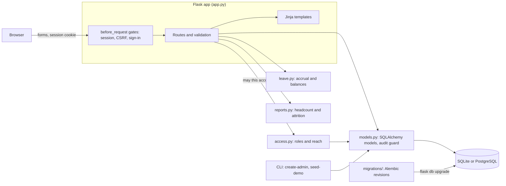
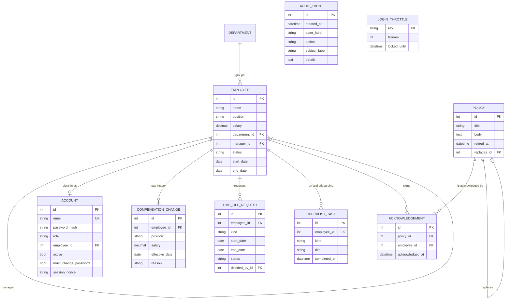
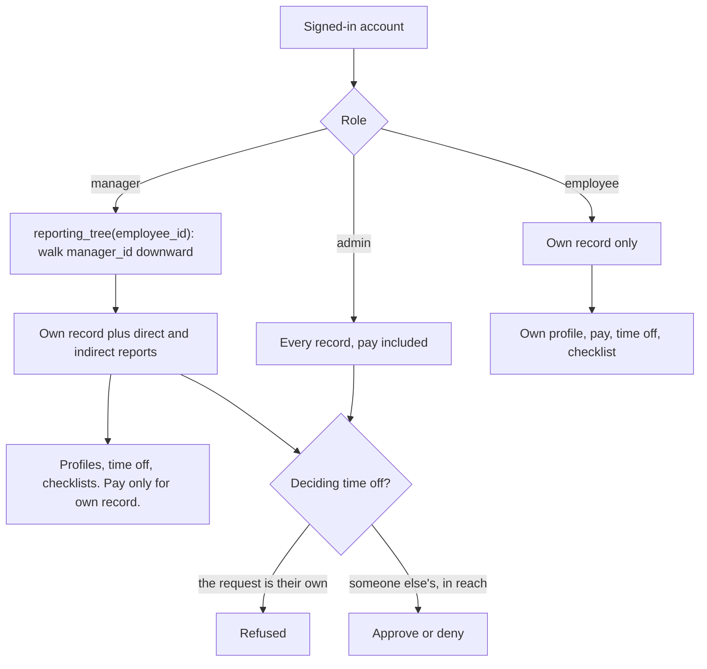
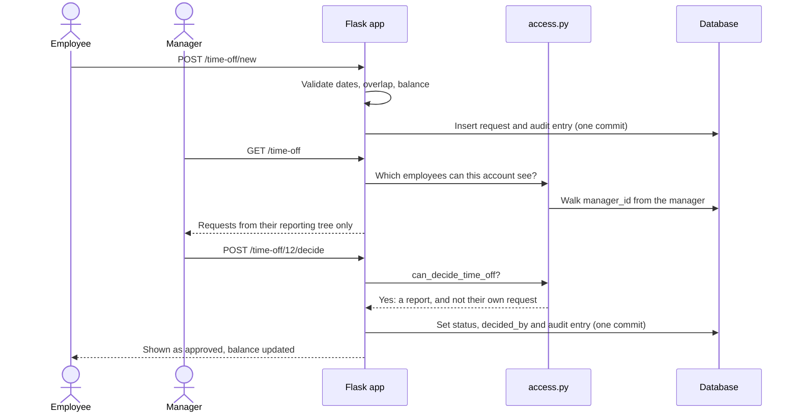
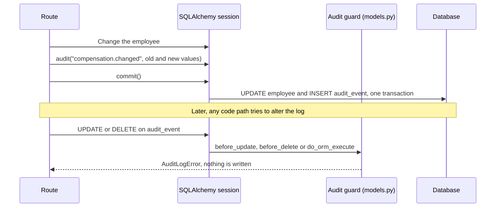

# Architecture

PeopleBase is a server-rendered Flask application. Routes live in `app.py`;
the rules that deserve reading on their own are split into small modules with
no Flask imports. The threat model is in [security.md](security.md).

## Components

What to notice: `leave.py` and `reports.py` take plain values and return plain
values, so their rules are tested without a database. `access.py` is the only
place that knows what a role may do; routes and templates ask it and never
compare role names themselves. The app never creates or alters tables at
startup. The schema belongs to the migrations.

## Data model

What to notice: `EMPLOYEE.manager_id` points back at `EMPLOYEE`, and that one
column is what every manager permission is computed from. `ACCOUNT` is
separate from `EMPLOYEE`, so a record can exist without a sign-in and an HR
admin can exist without a record. `AUDIT_EVENT` has no foreign keys on
purpose: it copies names in as text, so an entry still reads correctly after
the person it mentions is renamed or deleted. `LOGIN_THROTTLE` is keyed by the
email or address that was typed, not by an account.

## Roles and reach

What to notice: the role picks a branch and the reporting line fills it in.
`reporting_tree` runs one query for every `(id, manager_id)` pair and walks it
in memory, visiting each person once, so a loop in bad data cannot hang a
request. The tree is rebuilt on each request, so moving someone to a new
manager changes who can see them on the next page load. The full table of who
may do what is in [security.md](security.md#access-rules).

## Time-off approval

What to notice: the form that decides a request has two buttons and no field
naming the approver. A request for a record outside the caller's reach
answers 404 before the decision is even parsed. A request that runs past the
leave balance is not refused; the requester and the approver are both told by
how much, and the approver decides.

## The audit log

What to notice: the entry is added to the same session as the change, so the
commit saves both or neither. Three SQLAlchemy hooks cover the ways a row
could be altered through the ORM: per-row update, per-row delete and bulk
statements. Someone with direct database access is outside this guarantee,
and [security.md](security.md#what-this-does-not-cover) says so.

## Request handling

- Three `before_request` steps run in order: resolve the session cookie to an
  account (or clear it), check the CSRF token on unsafe methods, then require
  a sign-in for everything except `/login` and static files. An account with
  a temporary password is sent to the password page until it is replaced.
- A session is the account id, the account's nonce and the sign-in time in
  Flask's signed cookie. It is accepted only while the account is active, the
  nonce matches and less than 12 hours have passed.
- Directory search builds one list of SQL filters shared by the page, its
  totals and the CSV export, so all three describe the same people.
- Every response gets a Content-Security-Policy without `unsafe-inline`,
  `nosniff`, frame denial, a Referrer-Policy and a Permissions-Policy. Every
  page that is not a static file is `Cache-Control: no-store`. Bodies over
  64 KiB get 413.
- Errors render `error.html`. A 500 rolls back the session and shows a generic
  message; the traceback goes only to the server log.

## Validation

All form input is checked in plain functions next to the routes:

- Text: required where needed, length-limited, no control characters.
- Salary: a plain ASCII number, finite, 0 to 999,999,999.99, rounded half-up
  to cents.
- Dates: `YYYY-MM-DD`, a real calendar date between 1900 and 2100.
- Ids: ASCII digits, at most nine of them, and the record must exist.
- Managers: not the employee, not someone who has left, and not anyone who
  already reports up to the employee.
- Time off: end on or after start, at most 60 days, no overlap with the same
  person's pending or approved time off.
- Passwords: 12 to 128 characters, not the account's email, not the password
  just in use.

## Leave balances

`leave.py` works per calendar year in working days (Monday to Friday).
Vacation (20 days) and sick leave (10) accrue a twelfth at the start of each
month from the month someone started; personal days (3) arrive in full at the
start of the year. Approved leave is used and pending leave is held back.
There are no public holidays or part-time schedules.

## Headcount and attrition

`reports.py` places each person on staff from their start date through their
last day and builds twelve monthly rows where ending headcount always equals
starting headcount plus hires minus leavers. Attrition is leavers over average
headcount. People marked as left with no last day cannot be placed in a month,
so they are left out and counted separately on the page.

## Schema and migrations

The schema is owned by Alembic revisions in `migrations/versions`, run through
Flask-Migrate with `flask --app app db upgrade`.

| Revision | Adds |
| --- | --- |
| 0001 | The four original tables. Creates only what is missing, so an empty database, a first-release database and a four-table database from before migrations all end up identical. |
| 0002 | `account` and `login_throttle` |
| 0003 | `audit_event` |
| 0004 | `employee.end_date` and `checklist_task` |
| 0005 | `policy` and `acknowledgement` |

`tests/test_migrations.py` upgrades each historical shape with data in it and
compares the result to the models with Alembic's own schema diff. It runs on
SQLite in CI. With `TEST_POSTGRES_URL` set it runs on PostgreSQL too, which
was last done on 2026-11-12 against PostgreSQL 17.11 with psycopg 3. The rest
of the suite builds its schema straight from the models for speed.

## Configuration

`SECRET_KEY` must be set; the factory raises at startup without it. SQLite at
`instance/employees.db` is the default and `DATABASE_URL` points SQLAlchemy at
any other database. `SESSION_COOKIE_SECURE=1` marks the session cookie Secure.

## Production gaps

PeopleBase is a portfolio project, not a product. Before holding real
employee data it would need at least multi-factor or single sign-on, emailed
password reset, encryption at rest, backups, data-retention rules, a rate
limiter in front of every route and a tamper-evident audit store.
